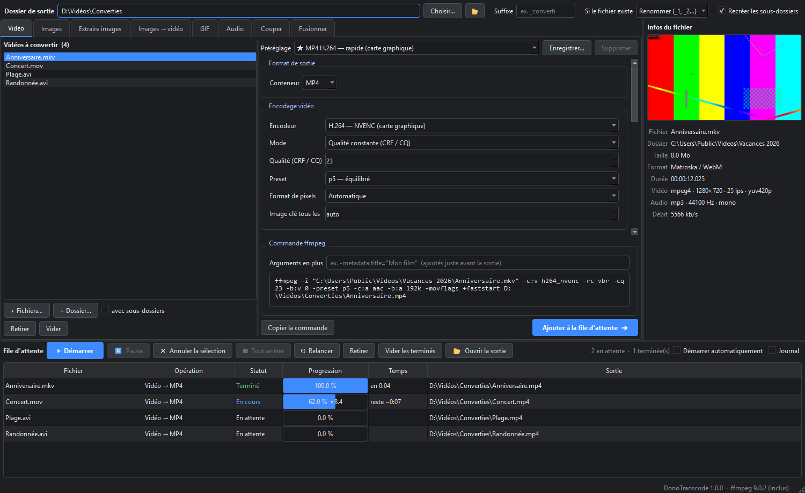

# DonoTranscode

Application Windows simple et complète autour de **ffmpeg** : convertir des vidéos, des images et de l'audio,
un fichier ou des dossiers entiers, avec une file d'attente et tous les réglages accessibles.
Interface sombre en Python + PySide6, encodage au choix sur le processeur ou la carte graphique NVIDIA (NVENC).



## Fonctions

| Onglet | Ce qu'il fait |
|---|---|
| **Vidéo** | Conversion MP4 / MKV / WebM / MOV / AVI : codec, CRF ou débit, preset, tune, format de pixels, résolution, fps, rotation, désentrelacement, audio, pistes, sous-titres, découpe début / fin |
| **Images** | Conversion JPG / PNG / WebP / BMP / TIFF, recadrage (ratio centré ou manuel), redimensionnement (largeur, hauteur, tenir, remplir, exact), rotation, luminosité / contraste / saturation / gamma, noir et blanc |
| **Extraire images** | Vidéo → images : toutes, N par seconde, 1 toutes les N s, N réparties sur la vidéo, images clés, changements de scène |
| **Images → vidéo** | Animation, timelapse ou diaporama, tailles différentes gérées, musique optionnelle |
| **GIF** | Vidéo → GIF (palette optimisée, tramage réglable) ou WebP animé |
| **Audio** | Extraire / convertir : MP3 (CBR / VBR), M4A, Opus, OGG, FLAC, WAV ; volume, normalisation EBU R128, fondus, choix de la piste |
| **Couper** | Lecteur vidéo intégré, segments début / fin, coupe rapide (sans réencoder) ou précise à l'image près, réunion des segments |
| **Fusionner** | Vidéos bout à bout : rapide (copie) ou réencodée (tailles, codecs et fps différents) |

**Partout :**
- glisser-déposer de fichiers ou de dossiers (avec sous-dossiers) ;
- dossier de sortie au choix, suffixe, règle « si le fichier existe » (renommer / écraser / ignorer), structure des dossiers recréée ;
- préréglages intégrés (★) et préréglages perso enregistrables ;
- aperçu de la commande ffmpeg exacte, copiable, et champ « arguments en plus » ;
- panneau d'infos avec miniature (codec, résolution, fps, durée, audio, débit) ;
- file d'attente : vraie pause / reprise, annulation, relance, temps restant, vitesse, journal ffmpeg.

**Encodeurs :** H.264 (x264 / NVENC), H.265 (x265 / NVENC), AV1 (SVT-AV1), VP9, ou copie sans réencoder.

## Installation (Windows 10 / 11)

1. Avoir **Python 3.11, 3.12 ou 3.13** (`winget install Python.Python.3.11`).
2. Télécharger ce dépôt (`git clone https://github.com/ArthureCodage/DonoTranscode` ou *Code → Download ZIP*).
3. Double-clic sur **`install.bat`** : crée l'environnement Python, installe PySide6 et télécharge ffmpeg
   (build GPL de [BtbN](https://github.com/BtbN/FFmpeg-Builds), ~200 Mo) dans `bin\`.
4. Double-clic sur **`Lancer DonoTranscode.bat`**.

> Tu as déjà ffmpeg ? Copie simplement `ffmpeg.exe` et `ffprobe.exe` dans `bin\` avant l'installation.
> Sans `bin\`, l'appli utilise le ffmpeg du PATH.

## Bon à savoir

- **NVENC** demande une carte NVIDIA récente. Sur une RTX 20xx : pas d'AV1 NVENC et pas de H.264 10 bits (utiliser HEVC NVENC).
- Le **JPG** ne garde pas la transparence.
- La coupe **rapide** se cale sur l'image clé précédente ; utiliser **Précis** pour couper à l'image près.
- Une tâche à la fois dans la file, pour garder le PC utilisable.
- Préréglages perso : `%APPDATA%\DonoTranscode\presets.json`.

## Structure

```
donotranscode/
  ffmpeg.py         accès ffmpeg / ffprobe, infos, miniatures, outils de temps
  core.py           tâche (Job) et erreurs utilisateur
  queue.py          file d'attente et exécution de ffmpeg
  widgets.py        liste de fichiers, barre de sortie, infos, préréglages
  settings_form.py  lecture / écriture automatique des réglages
  presets.py        préréglages perso
  theme.py          thème sombre et icône
  main_window.py    fenêtre principale
  tabs/             un fichier par onglet
install.bat / install.ps1   installation
Lancer DonoTranscode.bat    lanceur
```

## Historique

- **v1.0.0** (2026-10-25) — Première version : 8 onglets, file d'attente, préréglages, panneau d'infos.
  Testée sur 37 conversions réelles (x264, NVENC H.264 / HEVC 10 bits, VP9, AV1, copie, images,
  extraction, diaporama, GIF / WebP, audio, coupe, fusion).

## Licence

Code sous licence [MIT](LICENSE). ffmpeg n'est pas inclus dans le dépôt : il est téléchargé à l'installation
et reste sous sa propre licence (GPL).
